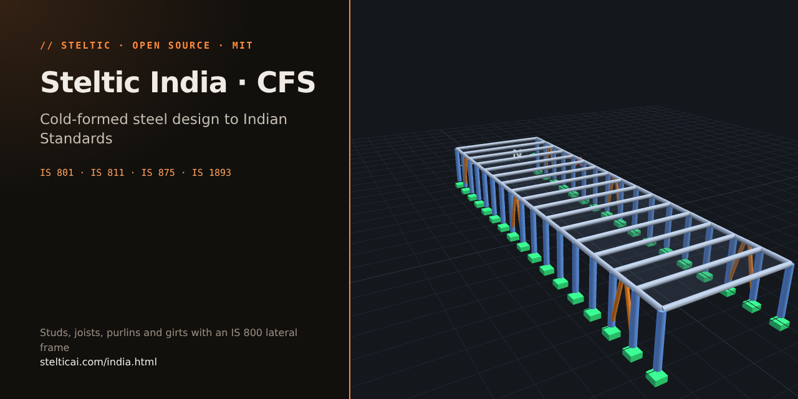

# Steltic India CFS

[](LICENSE)
[](https://github.com/Steltic/steltic_CFS_india/releases)
[](pyproject.toml)



Cold-formed members (studs, tracks, joists, purlins, girts) to IS 801 and IS 811 with the lateral system designed as an IS 800 Section 12 braced or moment frame; IS 875 and IS 1893 loads.

- **Start with the Hub:** most people install this module through
  [Steltic Hub India](https://github.com/Steltic/steltic_hub_india), which sets everything up.
- **See the output first:** 15 worked Indian designs with reports and 3D models at
  [stelticai.com/india.html](https://stelticai.com/india.html).
- **Setup video:** [YouTube](https://www.youtube.com/watch?v=lcKjj9wLcno).

> Steltic assists with structural design but does not replace a licensed professional engineer. All output
> must be independently verified.


This repository is the **India CFS variant** of [Steltic/steltic_cfs](https://github.com/Steltic/steltic_cfs)
(USA AISI/ASCE). Do **not** confuse the two. Design authority: **IS 801:1975** + **IS 811:1987**
(+ Amd1 when relevant). Loads: **IS 875 Parts 1–5** and **IS 1893 Part 1:2016**, retrieved LIVE
via RAG every job (not hardcoded in the engine).

```
browser ──▶ FastAPI app (localhost) ──▶ your LLM (key in app memory, never stored)
                 │  parses tool calls
                 ▼
           sandbox executor (run_python only) — Docker when available
                 │
           steel engine + OpenSees ─▶ report.html + viewer_3d.html
```

> **Not for construction.** Every output is produced by your own AI model, may be incomplete or
> incorrect, and must be independently checked and sealed by a licensed professional engineer before
> any use for design, construction, or permitting. See [DISCLAIMER.md](DISCLAIMER.md).

## For videos and demonstrations see [stelticai.com](https://stelticai.com)

## Install & run

Most people should start with [Steltic Hub](https://github.com/Steltic/steltic_hub_india), which clones and installs
this module for you. To run this module on its own, install it from GitHub. It needs **Python 3.10–3.12**
(openseespy, the analysis engine, ships compiled binaries for those versions only); 3.12 is recommended.

**Windows (PowerShell)**

```powershell
git clone https://github.com/Steltic/steltic_CFS_india
cd steltic_CFS_india
py -3.12 -m venv .venv
.venv\Scripts\Activate.ps1
pip install -e .
steltic-cfs-india            # starts on http://127.0.0.1:8000 and opens your browser
```

**macOS / Linux**

```bash
git clone https://github.com/Steltic/steltic_CFS_india
cd steltic_CFS_india
python3.12 -m venv .venv
source .venv/bin/activate
pip install -e .
steltic-cfs-india            # starts on http://127.0.0.1:8000 and opens your browser
```

The install brings the full engine (openseespy, numpy, scipy, matplotlib, about 400 MB), so designs run without
Docker. To run with a `.env` file of settings, use `./run_local.sh` or `.\run_local.ps1` instead of `steltic-cfs-india`.

**Update:** in the repo folder, `git pull`, then `pip install -e .` again (needed only when `pyproject.toml`
changed, harmless otherwise).

First run: open **Settings**, enter your provider's **API base URL**, **API key**, and **model**.
Point `RAG_API_URL` at your IS corpus (see [IS corpus](#is-corpus-standards-grounding) below; never a USA
AISI / ASCE corpus). Then paste a brief and click **Design building**.

Offline smoke test: set Model to `MOCK`.

**Windows note:** if starting fails with *"Application Control policy has blocked this file"* or
*"os error 4551"*, Windows **Smart App Control** is blocking an unsigned Python. Use the signed python.org
build and recreate the environment:

```powershell
winget install Python.Python.3.12       # then open a new terminal in the repo folder
Remove-Item -Recurse -Force .venv
py -3.12 -m venv .venv
.venv\Scripts\Activate.ps1
pip install -e .
```

## Critical difference from USA steltic_cfs: loads are retrieved

| | USA `steltic_cfs` | India `steltic_CFS_india` |
|--|--|--|
| Design code | AISI S100 / S240 / S400 | IS 801:1975 + IS 811:1987 (+Amd1) |
| Loads | ASCE 7-22 **computed inside the engine** | IS 875 + IS 1893 **RAG every job → cfg['load_plan']** |
| Corpus | the USA corpus (AISC / ASCE / AISI) | your IS corpus (BIS documents), built in the Steltic hub |

The agent must call `search_engineering_standards` against `engineering_standards_IS875_P*` and
`engineering_standards_IS1893` before `pipeline.design_and_report`, then write retrieved factors into
`cfg['load_plan']` (schema in `steel_engine/india_loads.py`). Preflight fails closed if that is missing.
`cfs_pipeline.wind_story_forces()` and `engine3d.wind_forces()` raise on this branch.

## Sandbox

Same as USA: `EXECUTOR=auto|docker|subprocess`. Binds to 127.0.0.1; no auth — don't expose the port.

## IS corpus (standards grounding)

The agent grounds every load value, clause and factor in **your IS corpus, built in the Steltic hub from your own
licensed BIS PDFs** (see [`CORPUS_FIX_LLM_INSTRUCTIONS.md`](CORPUS_FIX_LLM_INSTRUCTIONS.md)). BIS standards are
copyrighted: no corpus is published with Steltic, and each user builds their own. Recommended workflow:

1. In the Steltic hub, convert your licensed BIS PDFs (first pass, Docling): **Standards** / **Convert**, then
   **Rebuild index** and **Validate**.
2. Zip that first-pass corpus with your PDFs and `CORPUS_FIX_LLM_INSTRUCTIONS.md`, and give them to a frontier LLM
   agent with code execution (the smarter the better). It fixes OCR, tables, figures and metadata, and returns a
   fixed corpus.
3. Replace the hub's corpus with it, then **Rebuild index** and **Validate**.
4. Point the engines at it: the hub sets `RAG_API_URL` (and `INDIA_CORPUS_ROOT`) for every engine it starts;
   standalone, set them yourself:

```bash
export RAG_API_URL=http://127.0.0.1:<port>/query      # the hub's IS corpus server (POST /query, GET /healthz)
export INDIA_CORPUS_ROOT=/path/to/your/is_corpus       # the corpus folder (documents/, indexes/, scripts/)
```

**Without a corpus** the engine still runs, but every standards retrieval comes back `found: false`. The gates
never turn a miss into a value: a found:false `load_plan.retrieval` row whose value is used needs the EOR record
`{value, source, cite, verify: True}` on the row (the vendored HR gate requires it) and the item in
`cfg['eor_inputs']`; the report discloses it as an engineer's assumption to verify. A found:false row without an EOR
record, or on a mandatory load stem, keeps the job `partial` (never COMPLETE).

### Retrieval details

Set `RAG_API_URL` / `RAG_API_TOKEN` / optionally `RAG_ALIASES_FILE` (default `$INDIA_CORPUS_ROOT/indexes/aliases.json`).
The tests run the vendored HR engine from `steel_engine/hr_vendor/`; set `STELTIC_HR_ROOT` to an HR checkout only for the
vendoring check. Misses report `not_found_kind` (`no_specification_index`, `document_not_in_corpus`, `not_tabulated`,
`server_error` — retry, never evidence of absence — or `term_absent_from_document`).

## Hot-rolled lateral frame (vendored HR engine)

The lateral frame runs in a subprocess (`steel_engine/hr_vendor_runner.py`) on the vendored HR India engine; the runner
translates the CFS cfg into the HR cfg (`SX`, `SY`, `xcoords` / `ycoords`, `seis`, `custom_build`, `roof_planes`,
`roof_regions`, plus `hr_cfg_extra` verbatim). The JSON frame builder is the shared HR `frame_build.py`
(`india_cfs_frame_build` is a thin wrapper); re-entrant plans get the IS 1893 Table 5(ii) flexible-diaphragm run with the
declared `lateral_frame.diaphragm_stiffness`; pitched roofs can be modelled at their true slope with
`lateral_frame.gold.roof_planes` (metres). The job's `rag/` hits are copied into the sub-run (`run_lateral(rag_dir=)`).
The contract lint `tests/test_fix_D05_contract_lint.py` checks that every top-level cfg key the CFS-only modules read is
named in `contract/*.md` or this README.

## License

MIT — see [LICENSE](LICENSE), [NOTICE](NOTICE) and [DISCLAIMER.md](DISCLAIMER.md).
